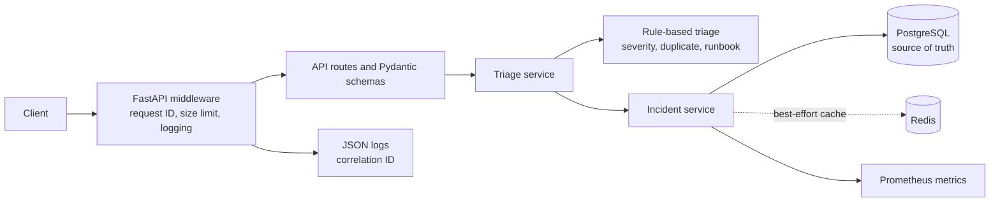

# A.I. Incident Triage Copilot

[](https://github.com/Professional-JFR/A.I.-Incident-Triage/actions/workflows/ci.yml)

An **A.I.-assisted incident triage backend** that analyzes incident text, predicts severity, suggests likely duplicates, and recommends a runbook.  
Built for practical backend + AI workflow demonstration using **Python/FastAPI**, **PostgreSQL**, **Redis**, and **Docker**.

## Motivation

Incident responders need a fast, consistent starting point when alerts arrive. This
service turns an incident report into a severity estimate, a possible duplicate, and
a runbook suggestion, then stores the result for retrieval. The current classifier
is intentionally deterministic and rule-based: it is explainable, runs offline, and
provides a baseline for evaluating future model-backed providers rather than claiming
production-grade AI accuracy.

## Tech Stack
- **Python**
- **FastAPI**
- **PostgreSQL**
- **Redis**
- **Docker / Docker Compose**
- **Pytest**

## Features
- **Health & readiness checks** for operational validation
- **Incident triage endpoint** with A.I.-style decision support
- **Severity prediction** from incident title/description
- **Duplicate detection** against recent incidents
- **Runbook recommendation** based on incident context
- **Persistent incident storage** + retrieval by `incident_id`

## Architecture and request flow



For `POST /incidents/triage`, the API validates and limits the request, the triage
service reads recent incidents and applies local rules, and the incident service
persists the result before returning it. Retrieval checks Redis first and falls back
to PostgreSQL. Redis is optional; PostgreSQL is required for writes and readiness.
Routes, orchestration, rules, persistence, configuration, and observability are kept
in separate modules so each can be tested independently.

## API Endpoints

### `GET /health`
Liveness check.

**Example response**
```json
{"status":"ok"}
```

### `GET /ready`
Readiness check for API dependencies.

**Example response**
```json
{"status":"ready","database":"ok","redis":"ok"}
```

### `POST /incidents/triage`
Validates, triages, and stores an incident. Text is trimmed; whitespace-only values
are rejected. Maximum lengths are 200 characters for `title`, 5,000 for
`description`, and 100 each for optional `service` and `source`. Request bodies
are limited to 1 MiB by default.

**Request body**
```json
{
  "title": "Payment API latency spike",
  "description": "Timeouts and degraded checkout responses",
  "service": "payments-api",
  "source": "monitoring"
}
```

**Example response**
```json
{
  "incident_id": "INC-3003131B",
  "predicted_severity": "high",
  "duplicate_of": "INC-7D962A80",
  "runbook_suggestion": "RB-002: Validate payment gateway and API error rates",
  "status": "triaged"
}
```

### `GET /incidents/{incident_id}`
Returns stored incident data + triage output.

### Error responses

Errors use FastAPI's JSON `detail` format. For example, invalid input returns
HTTP `422` with field-specific validation messages:

```json
{
  "detail": [
    {
      "type": "value_error",
      "loc": ["body", "title"],
      "msg": "Value error, must contain at least one non-whitespace character",
      "input": "   "
    }
  ]
}
```

Other expected responses:

| Status | Code / response | Meaning |
| --- | --- | --- |
| `404` | `{"detail":"Incident not found"}` | The incident ID does not exist. |
| `413` | `{"detail":{"code":"request_too_large","message":"Request body exceeds the configured size limit."}}` | The request body is larger than the configured limit. |
| `503` | `{"detail":{"code":"database_unavailable","message":"Incident storage is temporarily unavailable."}}` | PostgreSQL could not complete the operation. |

PostgreSQL is required to persist or retrieve incidents. Redis is only a cache:
when Redis reads or writes fail, reads fall back to PostgreSQL and successful
database writes are still returned. `/ready` reports `"redis":"degraded"` while
the database is available, and returns `503` only when PostgreSQL is unavailable.

---

## Quick Start

### 1) Clone
```bash
git clone https://github.com/Professional-JFR/A.I.-Incident-Triage.git
cd A.I.-Incident-Triage
```

### 2) Run with Docker
```bash
cp .env.example .env
docker compose up --build -d
```

### 3) Validate service
```bash
curl http://localhost:8000/health
curl http://localhost:8000/ready
```

Compose reads `.env` automatically. The included credentials are for local
development only; replace them before deploying the stack.

### Local Python development

```bash
python -m venv .venv
source .venv/bin/activate
make install
cp .env.example .env
```

For a host-run API, start the database and Redis services with
`docker compose up -d postgres redis`, then run:

```bash
POSTGRES_HOST=localhost REDIS_URL=redis://localhost:6379/0 alembic upgrade head
POSTGRES_HOST=localhost REDIS_URL=redis://localhost:6379/0 make run
```

On PowerShell, set the two environment variables with `$env:POSTGRES_HOST="localhost"`
and `$env:REDIS_URL="redis://localhost:6379/0"` before running the commands.

---

## PowerShell Demo Commands (Windows)

```powershell
$body = @{
  title       = "Payment API latency spike"
  description = "Timeouts and degraded checkout responses"
  service     = "payments-api"
  source      = "monitoring"
} | ConvertTo-Json

$response = Invoke-RestMethod -Method Post `
  -Uri "http://localhost:8000/incidents/triage" `
  -ContentType "application/json" `
  -Body $body

$response

Invoke-RestMethod -Method Get -Uri "http://localhost:8000/incidents/$($response.incident_id)"
```

---

## Results & Metrics (Baseline Demo)

- **Service availability checks:** **2/2 successful**
  - `GET /health` → `{"status":"ok"}`
  - `GET /ready` → `{"status":"ready","database":"ok","redis":"ok"}`
- **Triage workflow success rate:** **100%** for demonstrated run
- **Incident retrieval success rate:** **100%** for demonstrated run
- **A.I. output coverage:** **3/3 fields produced**
  - `predicted_severity`, `duplicate_of`, `runbook_suggestion`
- **End-to-end flow completion:** **1/1 successful**
  - ingest → triage → persist → retrieve

These baseline metrics validate functional correctness of the **A.I.-assisted triage pipeline** in a local containerized environment.

---

## Demo Evidence

Screenshots of a local Docker Compose run (health/readiness checks, triage request,
incident retrieval). To reproduce them, follow the Quick Start and the demo commands above.


---

## API Reference

Interactive OpenAPI docs are served at `/docs` (Swagger UI), `/redoc`, and `/openapi.json`.
All endpoints declare response models: `TriageOut`, `IncidentDetailOut`, `HealthOut`,
`ReadyOut`, and `ErrorOut`. Non-validation errors use one envelope:

```json
{"detail": {"code": "database_unavailable", "message": "Incident storage is temporarily unavailable."}}
```

| Status | Meaning |
| --- | --- |
| `400` | Domain validation failed (`validation_error`). |
| `404` | Incident not found (`not_found`). |
| `413` | Request body too large (`request_too_large`). |
| `422` | Request schema validation failed (FastAPI field errors). |
| `500` | Unexpected triage failure (`triage_failed`). |
| `503` | PostgreSQL unavailable (`database_unavailable`). |

Every response carries an `X-Request-ID` header (a valid inbound value is reused). The same
ID appears as `correlation_id` in every JSON log line for that request.

## Configuration

Settings are loaded from environment variables or the root `.env` file and validated
at startup. Invalid values fail fast with a `ConfigurationError` naming the variable,
without logging its value.

| Variable | Default | Purpose |
| --- | --- | --- |
| `POSTGRES_HOST` | `postgres` | PostgreSQL hostname (`localhost` for host-run development). |
| `POSTGRES_PORT` | `5432` | PostgreSQL port. |
| `POSTGRES_DB` | `incident_triage` | Database name. |
| `POSTGRES_USER` | `postgres` | Database user. |
| `POSTGRES_PASSWORD` | `postgres` | Development password; use a secret in deployment. |
| `DATABASE_URL` | unset | Optional PostgreSQL URL that overrides the connection components above. |
| `REDIS_URL` | `redis://redis:6379/0` | Redis connection URL. |
| `MAX_REQUEST_BYTES` | `1048576` | Maximum request body size (1 MiB). |
| `LOG_LEVEL` | `INFO` | Structured logging threshold. |
| `CACHE_TTL_SECONDS` | `3600` | Redis incident cache lifetime. |
| `RECENT_INCIDENT_LIMIT` | `50` | Recent incidents considered for duplicate detection. |
| `STARTUP_DB_RETRIES` | `20` | Startup attempts for transient PostgreSQL connection failures. |
| `STARTUP_DB_RETRY_DELAY_SECONDS` | `1.5` | Base delay for exponential startup retry backoff. |
| `SKIP_STARTUP_INIT` | `false` | Test-only switch that skips startup dependency checks; do not enable in deployments. |

## Database migrations

Schema changes are managed with Alembic (`alembic/versions`). The Docker image and Compose
file run `alembic upgrade head` before starting the API. Locally:

```bash
alembic upgrade head      # apply migrations (creates indices on created_at, service)
alembic downgrade base    # roll back
```

The API refuses to start if the schema is missing and tells you to run the migration.

## Metrics and observability

Prometheus metrics are exposed at `GET /metrics`:

| Metric | Type | Meaning |
| --- | --- | --- |
| `triage_decisions_total{severity}` | counter | Decisions per severity. |
| `incidents_triaged_total`, `duplicates_detected_total` | counter | Duplicate rate = duplicates / triaged. |
| `cache_operations_total{result}` | counter | `hit`, `miss`, `error` lookups. |
| `http_request_duration_seconds{method,path,status}` | histogram | API latency (use `histogram_quantile`). |
| `db_query_duration_seconds{operation}` | histogram | Database latency. |
| `validation_errors_total{field}` | counter | Validation errors by field. |

Example: `histogram_quantile(0.95, sum by (le) (rate(http_request_duration_seconds_bucket[5m])))`.

## Architecture decision records

- **ADR-1 Service layer:** routes in `app/main.py` delegate to `app/services/*`, which use
  `app/persistence/database.py` (PostgreSQL) and `app/persistence/cache.py` (Redis).
- **ADR-2 Redis is optional:** cache errors are logged and counted, never raised; PostgreSQL is
  the source of truth. `/ready` returns `503` only for PostgreSQL failures.
- **ADR-3 Alembic migrations:** replaces `CREATE TABLE IF NOT EXISTS` at startup so schema is
  versioned; the first migration is idempotent for pre-existing databases.
- **ADR-4 Lazy, validated settings:** configuration is loaded with Pydantic Settings at startup,
  not import time. Startup retries use exponential backoff for transient errors (connection
  refused, timeouts) and fail immediately on permanent ones (authentication, missing database).
- **ADR-5 Rule-based triage:** transparent baseline, measured by an offline evaluation harness
  (see below) so any future model can be compared against it.

## Evaluation

`python -m app.evaluation [dataset.json]` scores severity and runbook predictions against
`data/labeled_incidents.json` and prints accuracy, per-severity precision/recall, and mean
latency as JSON. The dataset is small and hand-labeled, so treat results as a regression
baseline, not a benchmark of real-world accuracy.

## Developer workflow

CI (`.github/workflows/ci.yml`) runs Ruff, mypy, pytest (80% coverage gate), the offline
evaluation, and a Docker image build on every push and pull request. Dependabot checks
Python and GitHub Actions dependencies weekly. Common local tasks:

```bash
make lint       # Ruff checks
make typecheck  # mypy
make test       # pytest with coverage gate
make format     # Ruff autofix and formatter
make docker     # build and run with Docker Compose
pre-commit install
```

The pytest suite is offline by default and mocks storage. Integration tests marked
`integration` use live PostgreSQL and Redis and are excluded from the default coverage
run; use `pytest -m integration` with the Compose dependencies running to execute them.

## Troubleshooting

| Symptom | Cause / fix |
| --- | --- |
| Startup fails with `configuration_error` | A variable is invalid; the log names it. |
| `Unable to connect to PostgreSQL ... permanent` | Check credentials / database name. |
| `Gave up after N attempts` | PostgreSQL unreachable; check host, port, and network. |
| `Database schema is missing` | Run `alembic upgrade head`. |
| `/ready` shows `"redis":"degraded"` | Redis is down; the API still works via PostgreSQL. |
| `503 database_unavailable` | PostgreSQL failed mid-request; see `storage.*` log events. |

---

## Testing

```bash
pytest                      # unit + API tests (mocked storage), enforces 80% coverage
pytest -m integration       # real PostgreSQL + Redis (skipped if unreachable)
```

Integration tests live in `tests/integration`. Start dependencies with
`docker compose up -d postgres redis` and run
`POSTGRES_HOST=localhost REDIS_URL=redis://localhost:6379/0 pytest -m integration`.
To add a test, mark it with `unit`, `integration`, or `e2e`; use the `client` fixture
(mocked storage, `SKIP_STARTUP_INIT=1`) for unit tests and the `api`, `db`, `redis_cache`,
`redis_down`, and `sample_incident` fixtures for integration tests.

## Logging and deployment notes

The API writes one JSON log object per line. Set `LOG_LEVEL` to `DEBUG`, `INFO`,
`WARNING`, or `ERROR` to adjust verbosity; the default is `INFO`. Logs include
request outcomes, triage decisions, cache hits/misses, and storage failures.

The Docker image runs the API as a non-root `app` user. The Compose database
credentials are development defaults; replace them and avoid exposing database
ports when deploying outside a local development environment. `MAX_REQUEST_BYTES`
can be set to change the default 1 MiB request-body limit.

Rate limiting is intentionally placed at the reverse proxy or API gateway so it
can be shared across application workers. The following Nginx configuration is
commented out; enable and tune it in the proxy's `http` and `server` contexts
before exposing the service publicly:

```nginx
# http {
#     limit_req_zone $binary_remote_addr zone=triage:10m rate=10r/s;
#
#     server {
#         location = /incidents/triage {
#             limit_req zone=triage burst=20 nodelay;
#             proxy_pass http://api:8000;
#         }
#     }
# }
```

---

## Current Scope / Limitations
- Uses **baseline rule-based AI logic** (intentionally simple, transparent, and demo-friendly)
- Does not make external LLM/provider calls today; triage output is not a substitute for responder judgment
- Not yet optimized for high-throughput production scale
- Evaluation is an offline harness over a small labeled set; no model training pipeline yet

---

## Project Goal
Show a practical, end-to-end backend project that combines **API engineering**, **data persistence**, and **A.I.-assisted incident decision support** in a clean, reproducible setup.

## Future Improvements

- Replace baseline rule-based triage with a trained NLP/LLM-assisted classification pipeline for higher severity/duplicate accuracy.
- Add a mockable provider interface with strict output validation, bounded retries/timeouts, and rule-based fallback before enabling a remote model.
- Add authentication and role-based access control (RBAC) for secure incident operations.
- Introduce async queue-based processing (e.g., Celery/RQ) for higher-throughput triage workloads.
- Add observability stack (structured logs, metrics, tracing, dashboards, alerts) for production monitoring.
- Expand test coverage with integration/load tests and benchmark-driven performance targets.
