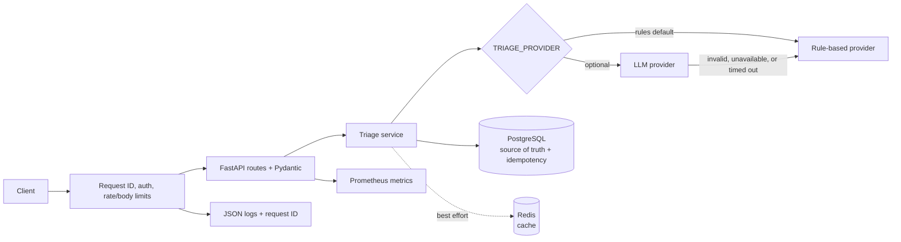

# A.I. Incident Triage

[](https://github.com/Professional-JFR/A.I.-Incident-Triage/actions/workflows/ci.yml)

**A production-aware incident-triage API built to make operational tradeoffs visible.** It validates and stores incoming incidents, predicts severity, identifies likely duplicates, and suggests a runbook. A deterministic provider is the default; an optional LLM adapter is validated, bounded by timeouts/retries, and falls back automatically.

## What it demonstrates

- FastAPI service boundaries, Pydantic contracts, PostgreSQL migrations, Redis best-effort caching, and tuned connection pooling.
- Provider abstraction with strict output validation, bounded LLM retries, fallback metrics, and offline-mockable tests.
- Optional API-key authentication, request-size limits, security headers, process-local rate limiting, and database-enforced idempotency.
- Correlated JSON logs, Prometheus metrics, an offline labeled-data evaluation harness, property-based and integration tests.
- Docker Compose development, CI coverage gate, pip-audit, CodeQL, and Trivy image scanning.

## Architecture



## Quickstart

```bash
git clone https://github.com/Professional-JFR/A.I.-Incident-Triage.git
cd A.I.-Incident-Triage
cp .env.example .env
docker compose up --build -d
curl http://localhost:8000/health
curl http://localhost:8000/ready
```

Submit an incident:

```bash
curl -X POST http://localhost:8000/incidents/triage \
  -H 'Content-Type: application/json' \
  -H 'Idempotency-Key: incident-2026-001' \
  -d '{"title":"Payment API timeout","description":"Checkout requests time out","service":"payments"}'
```

The sample credentials in `.env.example` are for local development only. Change them before deployment. To run the Python API on the host, install with `make install`, start dependencies with `docker compose up -d postgres redis`, then run `POSTGRES_HOST=localhost REDIS_URL=redis://localhost:6379/0 alembic upgrade head` and `POSTGRES_HOST=localhost REDIS_URL=redis://localhost:6379/0 make run`.

## API

| Method and path | Behavior |
| --- | --- |
| `GET /health` | Liveness check (no dependency calls). |
| `GET /ready` | PostgreSQL readiness; Redis degradation is reported but does not fail readiness. |
| `POST /incidents/triage` | Validate, triage, and persist; optional `Idempotency-Key` returns the original result on replay. |
| `GET /incidents/{incident_id}` | Return stored incident and triage result. |
| `GET /metrics` | Prometheus exposition format. |

OpenAPI docs are at `/docs`, `/redoc`, and `/openapi.json`. Input text is trimmed, Unicode is supported, and whitespace-only fields are rejected. Limits are 200 characters for title, 5,000 for description, 100 for service/source, and 1 MiB per request body by default.

Set `API_KEY_AUTH_ENABLED=true` and a strong `API_KEY` to require `X-API-Key`. Health, readiness, and metrics remain public unless `AUTH_PROTECT_PUBLIC_ENDPOINTS=true`. Optional in-process limiting is configured by `RATE_LIMIT_ENABLED`, `RATE_LIMIT_REQUESTS`, and `RATE_LIMIT_WINDOW_SECONDS`; it is per worker and is not a substitute for a shared gateway limiter.

## Results & Metrics

The checked-in, hand-labeled dataset is a small regression set, not a representative production benchmark. The reproducible harness reports measured sample count, severity/runbook accuracy, per-severity precision/recall, and mean classifier latency:

```bash
python -m app.evaluation
```

On the checked-in dataset, the current run produced **8 samples**, **100% severity accuracy**, **100% runbook accuracy**, and **0.113 ms mean classifier latency**. Each severity has support of 2 and measured precision/recall of 1.0. These figures describe only the small hand-labeled regression set and one local harness run.

Accuracy reflects only this dataset and must not be interpreted as real-world model performance. The measured latency excludes database/network I/O and the optional LLM provider.

Prometheus metrics are available at `/metrics`, including `triage_provider_fallbacks_total{provider}` for model-to-rules fallbacks, triage decisions by severity, duplicate detections, cache outcomes, HTTP latency, database latency, and validation errors.

## Design decisions and tradeoffs

- **Rules remain the default:** predictable, explainable, and offline. LLM use is opt-in; provider output is strictly validated, retries are bounded, and any provider error falls back to rules. The LLM provider uses an OpenAI-compatible chat-completions endpoint.
- **PostgreSQL is authoritative:** Redis accelerates reads and idempotency replays but is never required to write. A unique database key resolves concurrent idempotency requests even when Redis is unavailable.
- **Sync service and process-local rate limit:** the synchronous path keeps the current small API simple. Rate limiting is deliberately optional and per worker; use a reverse proxy/gateway for distributed enforcement.
- **No default authentication:** local and existing integrations remain compatible. Enable API-key authentication and protect health endpoints explicitly for deployments that require it.
- **Bounded database pool:** min/max sizes and wait/connect timeouts are configurable. Pool sizing should be coordinated with PostgreSQL connection limits and worker count.

## Failure modes

| Failure | Behavior |
| --- | --- |
| LLM timeout, non-success, malformed output, or invented duplicate ID | Bounded retries where transient, then rule-based fallback; fallback is logged and counted. |
| Redis unavailable | Triage and retrieval continue through PostgreSQL; cache operations are logged. |
| PostgreSQL unavailable | Writes/retrieval return a stable `503`; startup retries transient connection failures. |
| Duplicate idempotency key | Redis can return the cached response; otherwise a unique database index returns the canonical stored result, including concurrent requests. |
| Invalid input / oversized body | `422` schema validation / `413` request-size error before persistence. |
| API key rejected / rate threshold exceeded | `401` / `429`; health endpoints are exempt by default when auth is enabled. |

See [docs/ARCHITECTURE.md](docs/ARCHITECTURE.md) for sequence diagrams and [SECURITY.md](SECURITY.md) for security reporting and deployment guidance.

## Configuration

Settings load from the environment or root `.env`, are validated at startup, and never log secret values.

| Variable | Default | Purpose |
| --- | --- | --- |
| `DATABASE_URL` | unset | Optional PostgreSQL URL override. |
| `POSTGRES_HOST`, `POSTGRES_PORT`, `POSTGRES_DB`, `POSTGRES_USER`, `POSTGRES_PASSWORD` | Compose defaults | PostgreSQL connection components. |
| `REDIS_URL` | `redis://redis:6379/0` | Optional cache connection. |
| `DB_POOL_MIN_SIZE` / `DB_POOL_MAX_SIZE` | `1` / `10` | PostgreSQL pool bounds. |
| `DB_POOL_TIMEOUT_SECONDS` / `DB_CONNECT_TIMEOUT_SECONDS` | `5` / `5` | Pool wait and connection timeouts. |
| `MAX_REQUEST_BYTES` | `1048576` | Maximum body size. |
| `RECENT_INCIDENT_LIMIT` | `50` | Incidents considered for duplicate detection. |
| `CACHE_TTL_SECONDS` | `3600` | Incident and idempotency cache lifetime. |
| `STARTUP_DB_RETRIES` / `STARTUP_DB_RETRY_DELAY_SECONDS` | `20` / `1.5` | Transient database startup retry count and base delay. |
| `TRIAGE_PROVIDER` | `rules` | `rules` or opt-in `llm`. |
| `TRIAGE_LLM_ENDPOINT` / `TRIAGE_LLM_API_KEY` | unset | OpenAI-compatible endpoint and optional provider credential. |
| `TRIAGE_LLM_MODEL` | `incident-triage` | Provider model name. |
| `TRIAGE_LLM_TIMEOUT_SECONDS` | `5` | Per-attempt timeout. |
| `TRIAGE_LLM_RETRIES` / `TRIAGE_LLM_RETRY_DELAY_SECONDS` | `2` / `0.25` | Bounded exponential-backoff retries. |
| `API_KEY_AUTH_ENABLED` / `API_KEY` | `false` / unset | Enable request authentication and configure its secret. |
| `AUTH_PROTECT_PUBLIC_ENDPOINTS` | `false` | Also authenticate `/health`, `/ready`, and `/metrics`. |
| `RATE_LIMIT_ENABLED` | `false` | Enable per-process triage request limiting. |
| `RATE_LIMIT_REQUESTS` / `RATE_LIMIT_WINDOW_SECONDS` | `60` / `60` | Fixed-window limit. |
| `LOG_LEVEL` | `INFO` | Structured log threshold. |

All settings are also listed in `.env.example`. `SKIP_STARTUP_INIT` is test-only; never enable it in deployment.

## Development and validation

```bash
make install
make lint
make typecheck
make test
python -m app.evaluation
make audit
make docker-scan
make codeql
```

Unit/API tests run without external services. Integration tests require PostgreSQL and Redis: `docker compose up -d postgres redis`, then `POSTGRES_HOST=localhost REDIS_URL=redis://localhost:6379/0 pytest -m integration`. CI enforces at least 80% coverage. See [CONTRIBUTING.md](CONTRIBUTING.md).

## Roadmap

- Add distributed rate limiting and identity/authorization scopes if exposed beyond a trusted network.
- Expand the labeled dataset with responder-reviewed examples and establish quality/performance thresholds before changing provider defaults.
- Add tracing, dashboards, alerting, and load tests when deployment targets and SLOs are defined.
- Consider asynchronous work queues only when measured traffic requires them.
