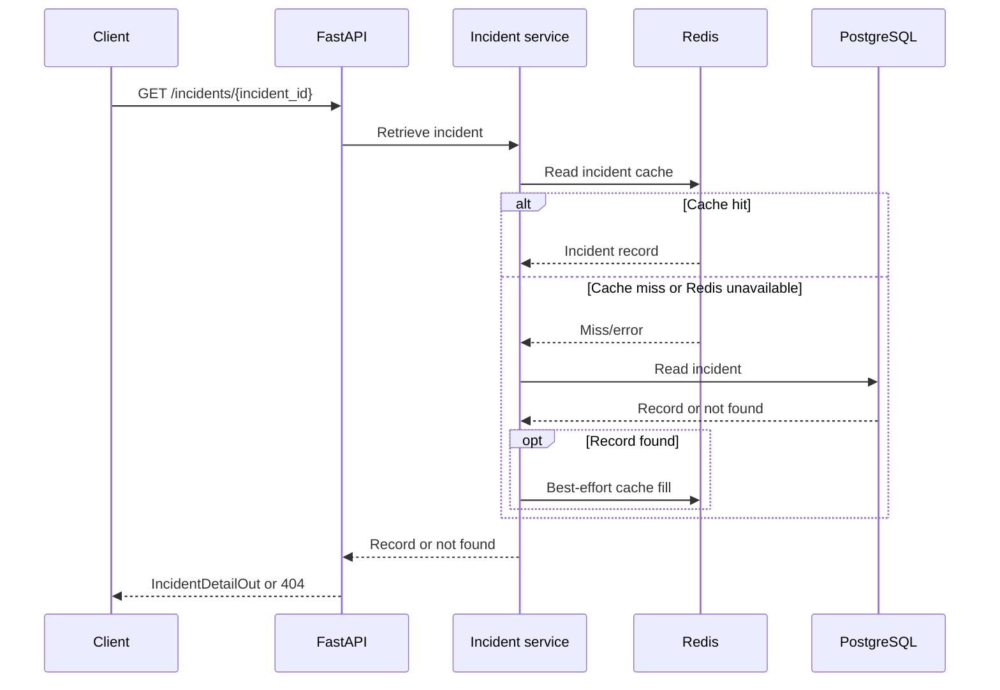

# Architecture

The HTTP layer in `app/main.py` handles request identity, authentication, rate/body limits, HTTP contracts, and response headers. `app/services/triage_service.py` coordinates provider decisions and persistence, `app/providers.py` contains the provider protocol and implementations, and `app/persistence/` isolates PostgreSQL and Redis. PostgreSQL is authoritative; cache failures are best-effort.

## Triage and fallback

```mermaid
sequenceDiagram
    autonumber
    participant C as Client
    participant A as FastAPI middleware/API
    participant S as Triage service
    participant R as Redis
    participant P as Provider
    participant DB as PostgreSQL
    C->>A: POST /incidents/triage + optional Idempotency-Key
    A->>A: Check body size, API key, and optional rate limit
    A->>S: Validated IncidentIn + SHA-256 key
    opt Idempotency key present
        S->>R: Lookup cached result
        R-->>S: Cached result or miss/unavailable
    end
    S->>DB: Fetch recent incidents
    S->>P: Triage incident with recent context
    alt TRIAGE_PROVIDER=llm
        P->>P: Call configured endpoint with timeout and bounded retries
        alt Valid, trusted decision
            P-->>S: Strictly validated decision
        else Error or invalid response
            P-->>S: Failure
            S->>S: Log and count provider fallback
            S->>P: Run deterministic rules
            P-->>S: Rule-based decision
        end
    else Default rules provider
        P-->>S: Rule-based decision
    end
    S->>DB: Insert incident; unique key resolves concurrent replays
    DB-->>S: Canonical persisted incident
    opt Idempotency key present
        S->>R: Best-effort cache canonical response
    end
    S-->>A: TriageOut
    A-->>C: JSON response + X-Request-ID
```

## Retrieval and degraded cache



## Persistence and lifecycle

- Alembic migrations version the `incidents` schema. The idempotency token is stored as a SHA-256 digest under a unique index; raw client keys are not written to PostgreSQL or logs.
- Connection pool bounds and wait/connect timeouts are configured by `DB_POOL_MIN_SIZE`, `DB_POOL_MAX_SIZE`, `DB_POOL_TIMEOUT_SECONDS`, and `DB_CONNECT_TIMEOUT_SECONDS`.
- The API opens the pool after PostgreSQL/schema checks and closes it, along with the Redis client, during the ASGI lifespan shutdown.
- The optional LLM provider performs synchronous OpenAI-compatible requests; configure concurrency and pool sizing accordingly. LLM calls are absent by default.
